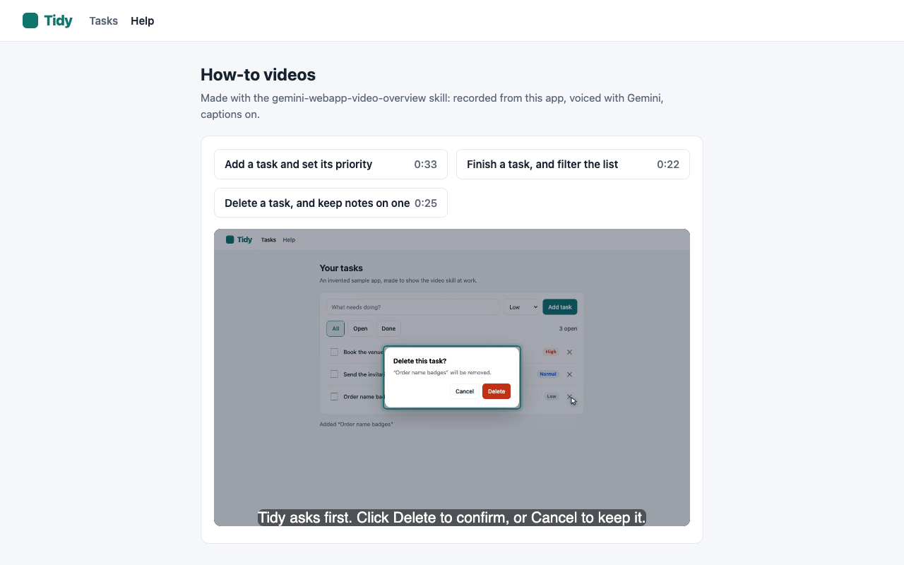

# gemini-webapp-video-overview

A Claude skill that makes short narrated videos of a real web app being used:
product overviews, feature how-tos, "what's new" clips and walkthroughs.

- **Recorded from the live app** with Playwright, with every click a real click.
- **A visible pointer** glides to each control before it is clicked, with a
  click ripple and highlight rings, drawn above modal dialogs too.
- **The audio is the master clock.** Each line is voiced first and measured,
  then every action is scheduled against the real timing (`"L4.start+0.6"`),
  so the pointer lands on the words.
- **Gemini TTS** by default (30 voices, a style direction that is not read
  aloud). **OpenAI TTS** as the fallback.
- **WebVTT captions, poster frames and a `videos.json` manifest**, ready to
  serve on a help page.
- **A checking step**: one frame per action, the spoken line at that moment,
  the volume, and the app's state.

## Install

The skill follows the open [Agent Skills](https://agentskills.io) format — a
folder with a `SKILL.md` — so the same folder works in Claude Code, Gemini CLI
and Antigravity. Clone once, then link it where your tool looks:

```bash
git clone git@github.com:danilogr/gemini-webapp-video-overview-skill.git
SKILL="$PWD/gemini-webapp-video-overview-skill/gemini-webapp-video-overview"
```

| Tool | Everywhere (your user) | One project only |
|---|---|---|
| Claude Code | `ln -s "$SKILL" ~/.claude/skills/` | `ln -s "$SKILL" .claude/skills/` |
| Gemini CLI | `gemini skills link "$SKILL"` | `ln -s "$SKILL" .agents/skills/` |
| Antigravity | `ln -s "$SKILL" ~/.gemini/config/skills/` | `ln -s "$SKILL" .agents/skills/` |

Create the target folder first if it does not exist (`mkdir -p .agents/skills`).
`.agents/skills/` in a project is read by both Gemini CLI and Antigravity.

Gemini CLI can also copy the skill in: `gemini skills install "$SKILL"`
(add `--scope workspace` for one project). Installing straight from the git
URL (`gemini skills install <url> --path gemini-webapp-video-overview`) needs
the repo to be readable without a login: the installer cannot ask for one,
so it fails on a private repo over both SSH and HTTPS. Clone, then install
from the folder.

Check it is found: `/skills` in Claude Code, `gemini skills list` in Gemini
CLI. Gemini CLI reads a project's skills only once you trust the folder.

Then ask for a video in plain words — "make a 30-second how-to video of
adding a task in the app at localhost:3000" — and the agent follows the skill.

## Tested with

| Agent | Result |
|---|---|
| Claude Code (Claude Opus) | Built the TodoMVC example and the three Tidy videos; a second agent with only the skill built a login/logout video of a public test site. |
| Gemini CLI 0.63.0 (`gemini-3.8-flash`) | With only the skill in `.agents/skills/`, made a 24 s video of Tidy from a one-paragraph request, checked its frames, and published it — see [`examples/tidy/made-by-gemini-cli/`](examples/tidy/made-by-gemini-cli/). Its own safety policy blocked `build_all.sh`; it built and published with `build.sh` and `publish.py` instead. |
| Antigravity | Not tested. It reads the same Agent Skills format from `.agents/skills/` or `~/.gemini/config/skills/`. |

## Requirements

- `python3`, `node`, `ffmpeg`
- Playwright with Chromium: `npm i -g playwright && npx playwright install chromium`
- A voice key in the environment: `GEMINI_API_KEY` (an `AIza…` or `AQ.…` key
  from https://aistudio.google.com/apikey), or `OPENAI_API_KEY`

## Try it

```bash
S=gemini-webapp-video-overview
cp -r $S/assets/example/todo-basics /tmp/
GEMINI_API_KEY=… $S/scripts/build.sh /tmp/todo-basics     # → /tmp/todo-basics/video.mp4
python3 $S/scripts/inspect.py /tmp/todo-basics              # frames to check
```

The example records the public TodoMVC demo at
https://demo.playwright.dev/todomvc/ — about 26 seconds, ~500 KB.

## A full example

[`examples/tidy/`](examples/tidy/) is a small invented task app and three
narrated videos the skill built of it: typing, a native menu, filters, a
confirm dialog (the pointer stays above it), a click that loads another page
(the pointer keeps its place), and a Help page that plays the videos from
`videos.json` with captions.



## Layout

```
gemini-webapp-video-overview/
  SKILL.md              the workflow Claude follows
  scripts/              build, voice, timing, recording, mixing, publishing, inspection
  references/           narration format, writing, voices, pitfalls, serving
  assets/example/       a complete working example
examples/tidy/          a sample app with three built videos and a Help page
```

Start with `SKILL.md`, then `references/narration-format.md`.
